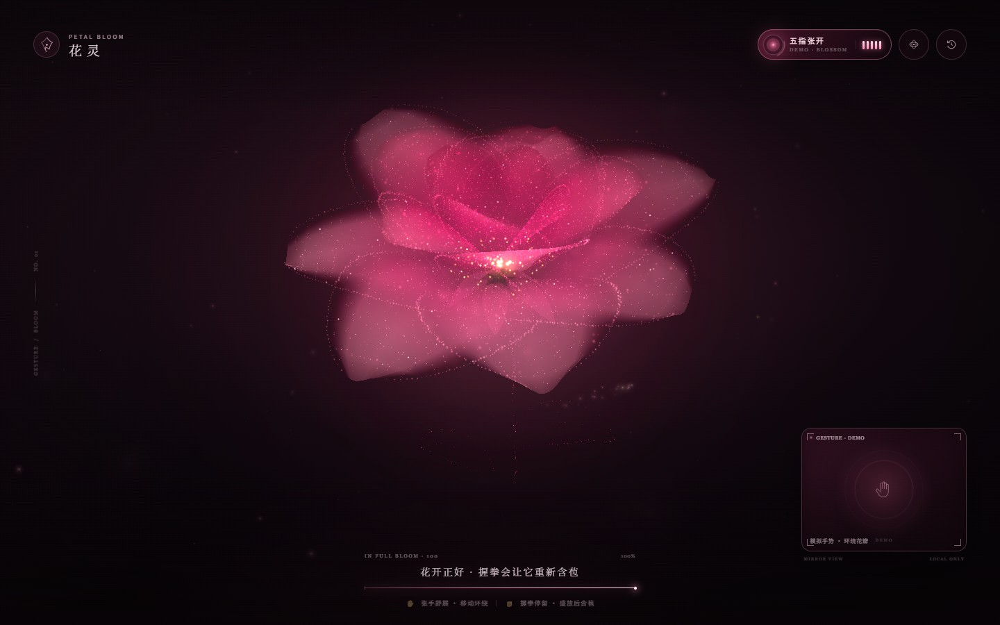

# 花灵 · Petal Bloom



> GitHub: https://github.com/twyu1/hualing

一苞粉色粒子花，等你在摄像头前张开手。

- **花苞**：粉色的粒子花苞在暗色雾气里呼吸式微动。
- **张开手指**：花苞会一层层舒展，直到完全盛开；中途握拳，花开会停在当下。
- **3D 环绕**：手掌平移即相对拖动视角，可连续环绕 360°；手停后轻微滑行。手掌上移视角变低，下移可俯视花心。
- **双手操控**：先入镜的手为主手，负责花开与闭合；任意张开的手都能拖动环绕，最近移动的手优先。两只手的指尖都能按压、推散粒子。
- **盛开后握拳**：单手时握拳即合拢；双手入镜时需要双手同时握拳，花朵才会重新合拢成花苞。张开手可以再次唤醒。
- **指尖互动**：手掌位置会映射成全屏光点。手划过花瓣时，粒子被按压、推散、滑动，并留下细碎光尘。
- **纯本地**：摄像头影像和手势识别都在浏览器本机完成，不会上传。

## 启动

### 一键启动

双击桌面上的 **花灵** 快捷方式，或双击项目里的 [`启动花灵.bat`](启动花灵.bat)。

它会自动打开一个命令行窗口、启动本地服务并打开浏览器。**这个命令行窗口需要一直开着**；关闭窗口或按 `Ctrl + C` 就会停止服务。

> 不能直接双击 `index.html`。页面依赖 ES 模块、Worker、MediaPipe 的 wasm/模型文件，并且摄像头需要 `localhost` 安全环境；用 `file://` 打开会被浏览器拦截。

### 手动启动

```powershell
cd "C:\Users\14304\Desktop\手势控制"
npm install
npm run dev
```

然后打开 **http://127.0.0.1:4173**，点击「开启花灵」并允许摄像头。

> 建议使用最新版 Chrome / Edge，并开启浏览器硬件加速。摄像头需要 `localhost` 或 HTTPS 环境。
>
> 页面会自动优先选择内置摄像头（如 `Integrated Camera`），并跳过 `Smart Connect`、`OBS`、`WebcastMate` 等虚拟摄像头，避免出现“摄像头打开了但画面不是本人”的情况。

## 操作

| 操作 | 效果 |
| --- | --- |
| 五指张开 | 花苞持续舒展，直到盛开 |
| 张开手掌平移 | 相对拖动 3D 环绕：可连续 360°，手停后轻微滑行 |
| 双手入镜 | 先入镜的手控花；任意张开的手都能环绕，最近移动优先；两只手都可与粒子互动 |
| 未盛开时握拳 | 花停在当前进度 |
| 盛开后握拳 | 单手时直接合拢；双手时需要双手同时握拳 |
| 指尖划过花瓣 | 粒子被推散、滑动，局部花瓣出现按压光晕 |
| 右上角轨道按钮 | 调整环绕灵敏度（40%–160%，100% ≈ 全幅划动 360°，自动保存） |
| `R` / 右上角重置 | 手动让花瓣收回花苞 |
| 「无摄像头 · 演示模式」 | 不调用摄像头，自动演示开放、环绕、合拢 |

也可以直接访问 `http://127.0.0.1:4173/?demo=1` 进入演示模式。

## 常见问题

- **页面打开了但摄像头没有画面**：先刷新页面。若是 Edge 已记住了某个虚拟摄像头，本页会自动切换到内置摄像头；也可以在地址栏左侧的摄像头图标中重新允许权限。
- **没有出现权限弹窗**：说明该地址之前已允许或拒绝过摄像头。打开 `edge://settings/content/camera`（或 Chrome 的对应设置），把 `127.0.0.1:4173` 设为允许后刷新。
- **想不接摄像头先看效果**：点击「无摄像头 · 演示模式」，或访问 `/?demo=1`。

## 构建

```powershell
npm run build
npm run preview
```

生产构建输出在 `dist/`。手部模型在 `public/models/hand_landmarker.task`，MediaPipe 运行时在 `public/wasm/`，均随项目本地加载。

## 实现说明

- **手势感知**：MediaPipe Tasks Vision · Hand Landmarker，`numHands: 2`，同时追踪最多两只手的 21 个关键点。每只手独立计算「张开 / 拳头」状态，并做多帧确认与迟滞。
- **Worker 推理**：手部模型在独立 Worker 中运行，主线程只接收关键点并做平滑。推理耗时不再阻塞花朵动画；Worker 不可用时自动回退到主线程。
- **双手角色**：先进入画面的手作为主手，负责开花与双拳闭合判定；主手短暂丢失 0.8 秒后由副手接管。第二只手需要稳定出现约 0.35 秒，且与主手有足够间距，才进入双手模式，避免把误检当成第二只手。
- **3D 环绕**：所有花瓣曲面、粒子、花苞、萼片与花蕊共用一套相机变换：绕垂直轴偏航、俯仰投影、透视缩放和深度排序。环绕采用相对拖动，不把手掌位置绝对映射到固定角度；任意张开的手都能控制，最近移动的手优先。手掌移动量转成角度增量，可在一次划动中连续转满 360°，手停后由阻尼弹簧自然收住。移动较慢时滤波更强以抑制抖动，移动加快时滤波迅速放开以减少延迟。
- **花形**：花苞使用曲面网格，盛放时由 3 层花瓣曲面、粒子边缘、金色花蕊和萼片组成；每片花瓣带独立延迟、缓动和回弹弧线。
- **开合**：盛开后握拳进入约 3.15 秒的 `easeInOutCubic` 闭合补间；双手入镜时要求双手同拳；闭合途中任意张手都会反向继续打开。
- **渲染**：WebGL 2 绘制花瓣曲面与点精灵粒子，Canvas 2D 负责环境尘埃和双指尖光晕/余烬。
- **互动**：两只手的指尖分别对粒子施加弹簧位移与切向拖曳，同时让花瓣曲面局部凹陷、提亮，形成双点按压和滑动感。
- **流畅度**：开合动画与指尖/环绕插值始终按 `requestAnimationFrame` 60fps 推进。摄像头采集为 640×480，Worker 读取 480px 宽的降采样帧；检测约 20–30fps，动画不等待推理。实测双手模式下画面稳定在 60fps，检测耗时约 35–50ms 但完全在 Worker 内完成。DPR 与光晕/尘埃画布设有上限，移动端自动降低粒子密度。
